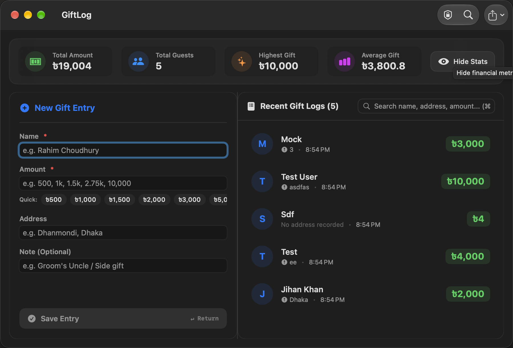
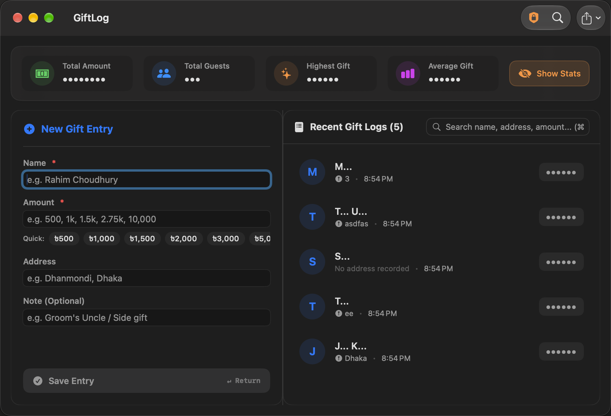
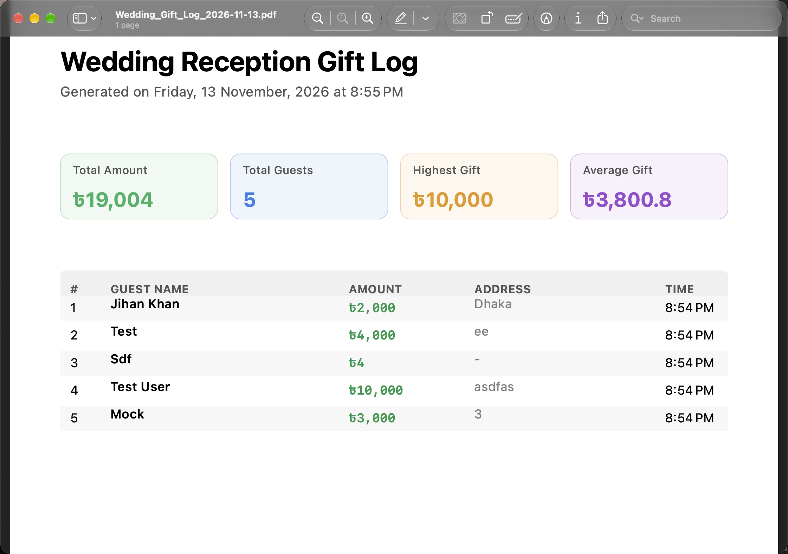

<div align="center">


# GiftLog

**A fast, private gift log for weddings, receptions, and every special occasion.**

Record every envelope in seconds, watch the totals add up, and export a beautiful summary when the night is over.

<p>
  <a href="https://github.com/0xJihan/Giftlog/releases/latest">
    
  </a>
  
  
  
</p>

[**Download for macOS →**](https://github.com/0xJihan/Giftlog/releases/latest) · [Features](#features) · [Installation](#installation) · [Usage](#usage) · [Build from source](#build-from-source)

</div>

---



<p align="center"><sub><b>The GiftLog window.</b> Live totals at the top, lightning-fast entry on the left, and a searchable log on the right.</sub></p>

## Why GiftLog?

At a wedding reception, the last thing you want to do is fight with a spreadsheet. GiftLog is a tiny native macOS app built for exactly one job: **writing down gifts quickly and accurately** while the line keeps moving.

- **Type, press Return, done.** No menus, no accounts, no setup.
- **See the night as it happens.** Totals, guest count, highest gift, and average update live.
- **Keep amounts private.** One shortcut hides every name and number from prying eyes.
- **Take the log home.** Export clean CSV, JSON, or a print-ready PDF summary.
- **Trust it with real data.** Everything stays on your Mac, and the app makes no network requests.

Built for Bangladeshi wedding gift logs, with amounts displayed in **Bangladeshi Taka (৳)**.

---

## Features

### ⚡ Fast, forgiving entry

- **Smart amount parsing** — enter `500`, `1k`, `1.5k`, `2.75k`, `10,000`, `৳2,500`, or `Tk 1500`. GiftLog converts it to a number and shows a live preview as you type.
- **Quick-amount chips** — one click for ৳500, ৳1,000, ৳1,500, ৳2,000, ৳3,000, ৳5,000, or ৳10,000.
- **Address suggestions** — previously used addresses appear as you type, so repeat locations take one click.
- **Optional notes** — add context such as “Groom’s uncle” or “Side gift”.
- **Keyboard-first flow** — move through fields with Return and save without touching the mouse.

### 📊 Live event dashboard

- **Total Amount** collected so far.
- **Total Guests** recorded.
- **Highest Gift** of the night.
- **Average Gift** across all entries.
- Animated number transitions keep the dashboard readable at a glance.

### 🕶️ Privacy Mode

- Toggle with **⌘P** or the **Hide Stats** button.
- Masks the dashboard totals, guest names, and every gift amount — perfect for a shared screen, a projector, or a curious onlooker.
- Your data is untouched; turn privacy mode off to see everything again instantly.

### 🔍 Searchable gift log

- Search across **name, address, note, and amount** with **⌘F**.
- **Double-click** any entry to edit it.
- **Right-click** for Edit and Delete.
- Hover states and a friendly empty state keep the list easy to scan.

### ↩️ Undo toast

- Every save shows a confirmation toast for **5 seconds** with an **Undo** button.
- Undo removes the saved entry *and* restores everything you typed, so a mistake never costs you a re-entry.

### 🛡️ Duplicate guard

- Before saving, GiftLog checks for an existing entry with the same **name, amount, and address**.
- You get a clear warning and can choose **Continue (Save Anyway)** or **Cancel** — no silent duplicates.

### 📤 Professional exports

- **CSV** for Excel, Numbers, or Google Sheets.
- **JSON** for backups, scripts, or moving data elsewhere.
- **PDF** for a beautiful printable summary, with summary cards, a numbered table, and automatic page numbering.
- Exports open a native save panel and reveal the finished file in Finder.

---

## Screenshots

<table>
  <tr>
    <td width="50%" valign="top">
      
      <p align="center"><sub><b>Privacy Mode</b><br/>Names, totals, and amounts are masked in one click.</sub></p>
    </td>
    <td width="50%" valign="top">
      
      <p align="center"><sub><b>PDF Export</b><br/>A clean, printable summary of the entire event.</sub></p>
    </td>
  </tr>
</table>

---

## Installation

### Requirements

| Requirement | Details |
|---|---|
| **macOS** | macOS 26.4 or later |
| **Chip** | Apple Silicon (M-series) |
| **Disk space** | About 2 MB |
| **Internet** | Not required — now or ever |

> [!IMPORTANT]
> The official release is an **Apple Silicon (arm64)** build. It will not run on Intel Macs.

### Download & install

1. Go to the [**latest release**](https://github.com/0xJihan/Giftlog/releases/latest).
2. Download the latest **`.dmg`** file.
3. Open the downloaded `GiftLog.dmg`.
4. Drag **GiftLog** into your **Applications** folder.
5. Eject the disk image.
6. Open **Applications** and double-click **GiftLog**.

That last step will trigger macOS Gatekeeper the first time. Follow the section below — it takes about 20 seconds.

### First launch: macOS will block the app

GiftLog is distributed **outside the Mac App Store and is not notarized by Apple**. It carries an ad-hoc signature, so Gatekeeper cannot verify a registered developer identity and refuses to launch it by default.

**This is expected, and it does not mean the app is unsafe.** GiftLog is:

- **100% open source** — every line of code is in this repository and can be inspected;
- **completely offline** — no networking code, no telemetry, no accounts;
- **sandboxed** — its only file access is through the macOS save panel you approve;
- **local-only** — your gift log never leaves your Mac.

#### Allow GiftLog once

1. Double-click **GiftLog** in Applications.
2. macOS shows a warning: *“Apple could not verify ‘GiftLog’ is free of malware…”*
3. Click **Done** — do **not** click **Move to Trash**.
4. Open **System Settings** from the Apple menu.
5. Go to **Privacy & Security** and scroll down to **Security**.
6. Find the message that GiftLog was blocked and click **Open Anyway**.
7. Authenticate with **Touch ID** or your Mac password.
8. Click **Open** in the confirmation dialog.

GiftLog opens. **You only need to do this once** — every later launch works normally.

> [!NOTE]
> On macOS Sequoia and later (including macOS 26), the old “right-click → Open” trick no longer bypasses Gatekeeper. The **Privacy & Security → Open Anyway** route above is the reliable method.

### Terminal method (alternative)

If you prefer the terminal, remove the quarantine flag macOS adds to downloaded apps:

```bash
xattr -dr com.apple.quarantine /Applications/GiftLog.app
open /Applications/GiftLog.app
```

Only do this for an app you obtained from this repository and trust.

### Troubleshooting

| Problem | Fix |
|---|---|
| *“Apple could not verify GiftLog…”* | Follow [Allow GiftLog once](#allow-giftlog-once). |
| *“GiftLog is damaged and can’t be opened.”* | Run `xattr -cr /Applications/GiftLog.app`, then open it again. |
| Still “damaged” after that | Re-download the `.dmg` — the download may be incomplete. |
| *“You do not have permission to open the application.”* | Make sure GiftLog is in `/Applications`, not still inside the `.dmg`. In Finder, use **File → Get Info** to check permissions. |
| *“GiftLog requires macOS 26.4 or later.”* | The prebuilt release targets macOS 26.4+. Update macOS, or [build from source](#build-from-source). |
| App opens but shows no data | Data is stored locally per macOS user. Make sure you are logged in as the same user who recorded the entries. |

---

## Build from source

Prefer to compile it yourself? That is the strongest way to verify exactly what the app does — and it avoids Gatekeeper entirely because you are the developer.

**Requirements:** Xcode 26 or newer, macOS 26.4+.

```bash
git clone https://github.com/0xJihan/Giftlog.git
cd Giftlog
open GiftLog.xcodeproj
```

In Xcode:

1. Select the **GiftLog** scheme.
2. Choose **My Mac** as the destination.
3. Press **⌘R** to build and run.

Or build from the command line:

```bash
xcodebuild \
  -project GiftLog.xcodeproj \
  -scheme GiftLog \
  -configuration Release \
  -derivedDataPath ./build \
  build

open build/Build/Products/Release/GiftLog.app
```

The app has **no external dependencies** — no Swift packages, no CocoaPods, no binary frameworks.

---

## Usage

### Record a gift

1. Type the **guest’s name** (required).
2. Type the **amount** (required). Use shorthand like `1.5k` or pick a quick amount.
3. Add an **address** and an optional **note**. Address suggestions appear from previous entries.
4. Press **Return** or click **Save Entry**.
5. The entry appears in the log, the dashboard updates, and an **Undo** toast appears for 5 seconds.

### Find and edit an entry

- Press **⌘F** and type a name, address, note, or amount.
- **Double-click** a row to edit it.
- **Right-click** a row to **Edit** or **Delete**.
- Press **Esc** in the edit sheet to cancel without saving.

### Keep amounts private

- Press **⌘P** or click **Hide Stats**.
- All totals, names, and amounts are masked.
- Press **⌘P** again to reveal them.

### Export the log

Use the **Export** menu in the toolbar, or press **⌘E** for a CSV. Every export opens a native save panel and reveals the file in Finder when finished.

| Format | Best for | What’s included |
|---|---|---|
| **CSV** | Excel, Numbers, Google Sheets | ID, name, amount (BDT), address, note, date, time |
| **JSON** | Backups, automation, migration | IDs, numeric and formatted amounts, address, note, ISO-8601 timestamp |
| **PDF** | Printing, sharing, record-keeping | Summary cards, numbered guest table, pagination, page footer |

Export files are named `Wedding_Gift_Log_YYYY-MM-DD` automatically.

---

## Keyboard shortcuts

| Shortcut | Action |
|---|---|
| **⌘N** | Focus the name field |
| **⌘F** | Focus search |
| **⌘P** | Toggle Privacy Mode |
| **⌘E** | Export as CSV |
| **Return** | Next field / save the entry |
| **Esc** | Cancel the edit sheet |
| **Double-click** | Edit an entry |
| **Right-click** | Edit or delete an entry |

---

## Privacy & security

GiftLog was built to be boring about data — in the best way.

- **No accounts.** There is nothing to sign up for.
- **No network access.** The app makes no requests; the sandboxed build has no network entitlement.
- **No analytics or telemetry.** Nothing is tracked, counted, or phoned home.
- **No third-party SDKs.** Just Apple frameworks.
- **Local storage.** Entries live in a SwiftData database inside the app’s sandboxed container on your Mac.
- **No cloud sync.** Your data does not leave the machine unless you export it yourself.

### About the notarization warning

Notarization is Apple’s automated malware scan and developer-identity check for distributed apps. GiftLog is not notarized because it is a free, open-source project distributed directly via GitHub Releases, without a paid Apple Developer ID.

The app is **ad-hoc signed**, which means macOS can confirm the bundle is intact but cannot verify *who* built it. Hence the warning. You can verify the signature yourself:

```bash
codesign -dv /Applications/GiftLog.app
# Signature=adhoc
# TeamIdentifier=not set
```

If you would rather not trust the prebuilt download, [build from source](#build-from-source). The complete source is right here.

> [!TIP]
> **Back up regularly.** Use **Export → JSON** before deleting the app or moving to a new Mac. GiftLog does not sync between machines, and deleting the app may leave the local database behind without a way to open it.

---

## Tech stack

| Layer | Technology |
|---|---|
| UI | SwiftUI |
| Persistence | SwiftData |
| PDF generation & save panels | AppKit / Core Graphics |
| Concurrency | Swift Concurrency |
| Distribution | Direct download, ad-hoc signed, sandboxed |
| Dependencies | None |

### Project structure

```text
GiftLog/
├── GiftLogApp.swift              # App entry point and SwiftData container
├── ContentView.swift
├── Models/
│   └── GiftEntry.swift           # SwiftData model
├── ViewModels/
│   └── GiftLogViewModel.swift    # Form state, validation, undo, duplicates
├── Views/
│   ├── MainAppView.swift         # Window, toolbar, keyboard shortcuts
│   └── Components/
│       ├── GiftEntryFormView.swift
│       ├── RecentEntriesListView.swift
│       ├── StatsBarView.swift
│       ├── EditEntrySheet.swift
│       └── UndoToastView.swift
├── Services/
│   └── ExportService.swift       # CSV, JSON, and PDF generation
└── Utilities/
    ├── SmartAmountParser.swift   # Amount parsing and ৳ formatting
    └── String+Extensions.swift
```

---

## FAQ

**Does GiftLog need an internet connection?**
No. It works fully offline, including installation and exports.

**Where is my data stored?**
In a local SwiftData database inside the app’s sandboxed container on your Mac. It is not uploaded anywhere.

**Does it sync between Macs?**
No. Use **Export → JSON** to move or back up data manually.

**Why isn’t it on the Mac App Store?**
GiftLog is a free open-source project distributed directly through GitHub Releases. App Store distribution requires a paid Apple Developer account and review process.

**Is it safe if Apple blocks it?**
The block is about Apple not being able to verify the developer’s identity — not about detected malware. GiftLog is open source, sandboxed, offline, and has no network entitlement. You can inspect the code or build it yourself.

**Can I use a currency other than BDT?**
Amounts are displayed in Bangladeshi Taka (৳). The amount parser accepts `৳`, `Tk`, `k` shorthand, and comma-separated numbers, but there is currently no currency selector.

**Can I undo a deletion?**
The undo toast only applies immediately after saving. Deleted entries are removed from the local database, so export a backup if you need a safety net.

**What happens if I delete the app?**
The app is removed, but its local database may remain in the sandboxed container. Export your log first if you may need it later.

---

## Contributing

Contributions, bug reports, and feature ideas are welcome.

1. Fork the repository.
2. Create a branch: `git checkout -b feature/your-idea`.
3. Make your changes and test them in Xcode.
4. Open a pull request with a clear description of the change.

If you find a bug, please open an issue with your macOS version, the steps to reproduce it, and what you expected to happen.

---

## License

GiftLog is open source and its full source code is available in this repository. The project does not currently include a formal license file; if you would like to reuse the code, please reach out via GitHub.

---

<div align="center">

<sub>Made with SwiftUI for Mac. No accounts. No cloud. No nonsense.</sub>

<br/><br/>

<a href="https://github.com/0xJihan/Giftlog/releases/latest"><b>Download GiftLog</b></a> · <a href="https://github.com/0xJihan/Giftlog">View source</a> · <a href="https://github.com/0xJihan/Giftlog/issues">Report an issue</a>

</div>
